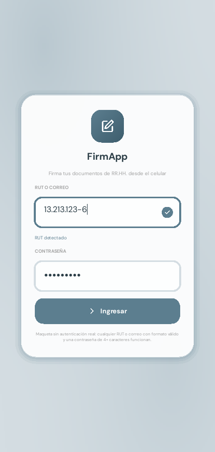
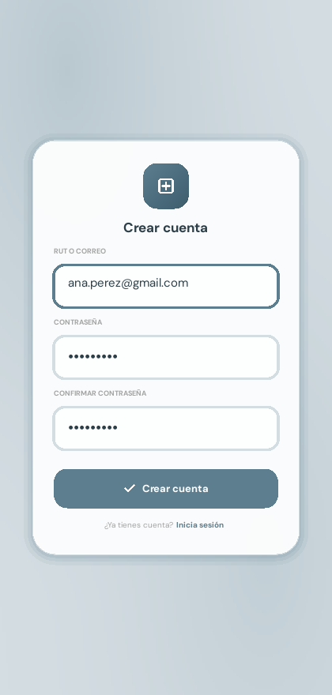
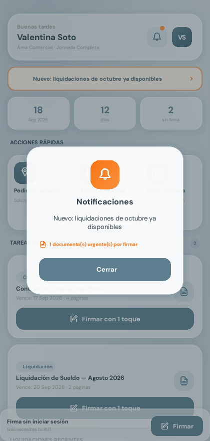

# FirmApp — Interfaz de Recursos Humanos (Kivy + KivyMD)

Maqueta funcional construida con **Kivy y KivyMD**, siguiendo la arquitectura
de la **Sesión 12 (KV Language y la separación de la lógica)**: la interfaz
visual vive completa en un archivo `.kv` y `main.py` solo contiene clases con
propiedades y métodos de evento.

## Problema que resuelve

En muchas empresas, firmar un documento de RR.HH. (contrato, liquidación de
sueldo, permiso) obliga al trabajador a imprimir, firmar a mano, escanear y
reenviar por correo — un proceso lento y que no todos pueden hacer desde el
celular. FirmApp propone firmar esos documentos desde el teléfono en un solo
flujo: ver los documentos pendientes, identificarse con el RUT o dibujar la
firma, y confirmar. Es una **maqueta** (no persiste datos, no valida contra
un servidor ni tiene validez legal real todavía): su objetivo es probar esa
experiencia de uso antes de construir el backend.

## Usuario objetivo

Trabajadores de una empresa (área comercial, operaciones, etc.) que reciben
documentos de RR.HH. para firmar de forma periódica (contratos, liquidaciones
de sueldo, permisos) y que hoy lo resuelven fuera de la app, muchas veces con
poca familiaridad con apps corporativas — de ahí que el flujo de firma se
haya reducido a dos pasos como máximo (RUT o dibujo) y textos cortos y
directos.

## Capturas de pantalla

| Login | Registro | Inicio | Firmar — RUT | Firmar — Dibujo | Éxito | Notificaciones |
|---|---|---|---|---|---|---|
|  |  |  |  |  |  |  |

## Fundamentación UX/UI

El diseño y la estructura de pantallas se basan en una encuesta de
diagnóstico real (11 respuestas) al socio comunitario y usuarios objetivo.
Metodología, hallazgos con evidencia y la matriz hallazgo → decisión de
diseño están en [`FUNDAMENTACION-UX-UI.md`](FUNDAMENTACION-UX-UI.md).

## Declaración de uso de IA

Se usó IA (Claude / Claude Code) en el desarrollo de este proyecto. La
declaración completa — herramienta, modelo, prompts, qué se tomó y qué se
descartó, qué se ajustó y por qué, y una reflexión — está en
[`USO_IA.md`](USO_IA.md), como exige la evaluación.

## Servicios implementados (dónde está cada uno)

La evaluación pide demostrar 4 servicios integrados. Esta tabla es el mapa
rápido para la defensa ("¿dónde está...?"):

| Servicio | Archivo(s) | Punto de entrada |
|---|---|---|
| **Autenticación** (registro + login) | `main.py` (`LoginScreen`, `RegisterScreen`), `data_manager.py` | `LoginScreen.login()` llama a `DataManager.authenticate()`; `RegisterScreen.register()` llama a `DataManager.register_user()` |
| **Persistencia en JSON** | `data_manager.py`, carpeta `data/` (se crea sola, no se versiona) | `DataManager.save_documents()` / `load_documents()` — `usuarios.json` y `documentos.json` |
| **Notificaciones** | `notifications.py`, `main.py` | `InterfazRRHHApp.go_to_home_after_login()` (documento urgente) y `.go_to_success()` (firma exitosa) llaman a `notifications.notify()` |
| **Remote Config** | `remote_config.py`, `remote/config.json`, `main.py` | `InterfazRRHHApp.build()` llama a `remote_config.fetch()`; `_apply_remote_config()` aplica el resultado |

Detalle de cada uno, con el razonamiento de diseño, en las secciones de
abajo.

## 1. Estructura de archivos

```
FirmApp/
├── main.py                    <- SOLO clases y lógica (hereda de MDApp)
│                                  ScreenManager + 5 pantallas: Login, Registro,
│                                  Inicio, Firmar, Éxito
├── interfazrrhh.kv            <- TODO el diseño visual (componentes KivyMD)
├── widgets.py                 <- Clases base sobre MDBoxLayout / MDCard / MDTextField
├── validators.py              <- Validación de RUT (dígito verificador) y correo
├── data_manager.py            <- Persistencia en JSON: usuarios y documentos
├── icons.py                   <- Los iconos SVG del diseño, redibujados para Kivy
├── theme.py                   <- Colores y tipografías
├── remote_config.py           <- Remote Config: fetch + fallback (UrlRequest)
├── notifications.py           <- Notificaciones locales con Plyer
├── remote/
│   └── config.json             <- JSON remoto real, servido desde GitHub (raw)
├── data/                       <- (se crea sola al ejecutar; no se versiona)
│   ├── usuarios.json            <- Cuentas registradas (contraseña con hash)
│   └── documentos.json          <- Qué está PENDING / qué pasó a RECENT
├── requirements.txt
├── FUNDAMENTACION-UX-UI.md    <- Investigación de usuarios y matriz hallazgo → decisión
├── USO_IA.md                  <- Declaración de uso de IA (este proyecto)
└── assets/
    ├── fonts/                  <- DMSans_18pt-{Regular,Bold}.ttf, JetBrainsMono-Regular.ttf
    └── screenshots/             <- Capturas usadas en este README
```

## Navegación (ScreenManager)

La maqueta original no tenía `ScreenManager`: era una sola pantalla con un
modal superpuesto. Se reestructuró a 5 pantallas navegables, tal como exige
la evaluación:

0. **`login`** (`LoginScreen`) — primera pantalla: RUT o correo + contraseña,
   validados de verdad contra las cuentas guardadas.
1. **`register`** (`RegisterScreen`) — crear una cuenta nueva.
2. **`home`** (`HomeScreen`) — tablero: saludo, estadísticas, acciones
   rápidas, tareas pendientes y liquidaciones recientes.
3. **`sign`** (`SignScreen`) — tarjeta de firma con dos pestañas (RUT /
   Dibujar) para el documento elegido en Inicio.
4. **`success`** (`SuccessScreen`) — confirmación de firma, con botón para
   volver a Inicio.

`InterfazRRHHApp.build()` crea las 5 pantallas una sola vez dentro de un
`ScreenManager` (arranca en `login`) y la navegación
(`go_to_register`, `go_to_login`, `go_to_home_after_login`, `go_to_sign`,
`go_to_success`, `go_home`) solo cambia `sm.current` — no crea ni destruye
widgets en cada viaje.

## Autenticación: Login y Registro

`LoginScreen` y `RegisterScreen` comparten el mismo campo de identificador
(`LoginIdentifierInput`, `widgets.py`) que acepta **RUT o correo** y los
distingue solo (si el texto tiene `@` es correo; si no, se formatea como
RUT en vivo, igual que en la pantalla de Firmar). La validación de
**formato** vive en `validators.py` — funciones puras, sin nada de Kivy:

- **RUT:** calcula el **dígito verificador real** (algoritmo módulo 11),
  no solo el largo — `11.111.111-1` es válido, `11.111.111-2` no.
- **Correo:** exige la forma `nombre@dominio.tld` (al menos un punto en el
  dominio, con un TLD de 2+ letras) — `nombre@gmail.com` sí,
  `nombre@gmail` no.

Eso es solo el formato. La autenticación **real** (¿existe esa cuenta? ¿la
contraseña es la correcta?) la hace `data_manager.py`:

- **Registro** (`RegisterScreen.register()` → `DataManager.register_user()`):
  guarda la cuenta nueva en `data/usuarios.json`, con la contraseña **con
  hash** (SHA-256, no en texto plano), y entra directo a Inicio — registro
  e ingreso combinados, como pide la evaluación.
- **Login** (`LoginScreen.login()` → `DataManager.authenticate()`): compara
  el identificador y el hash de la contraseña contra lo guardado. Si no
  coincide, se avisa en pantalla (`auth_feedback`) sin navegar a ningún
  lado — no es un error silencioso.
- **Cuenta de prueba precargada:** `demo@firmapp.cl` / `demo1234` — se crea
  sola la primera vez que se abre la app (si `data/usuarios.json` no
  existe todavía), para no depender de registrarse antes de poder entrar
  a hacer la demo.

**Efecto visual "modal flotante"**: `SignScreen` y `SuccessScreen` recuperan
el look de la v1 (tarjeta centrada sobre el Dashboard oscurecido) sin volver
a un modal real: `InterfazRRHHApp._snapshot_home()` toma una foto del
Dashboard (`Widget.export_as_image()`) justo antes de navegar y
`SnapshotBackground` (`widgets.py`) la pinta de fondo con un velo oscuro
encima. Se dibuja a mano con `kivy.graphics` (no con el widget `Image`)
porque `Image` no recalcula bien su tamaño cuando se le asigna una textura
sin pasar por su propiedad `source` — el mismo patrón que ya usa
`MeshBackground` para el fondo degradado.

## Persistencia de datos (JSON)

`data_manager.py` (clase `DataManager`) guarda y recupera, en archivos
JSON locales, los dos "datos críticos" de la app:

- **`data/usuarios.json`** — cuentas registradas (ver "Autenticación"
  arriba).
- **`data/documentos.json`** — qué documentos siguen `PENDING` y cuáles ya
  pasaron a `RECENT` (firmados).

**Cuándo se escribe:** `SignPanel.sign()` (`main.py`) llama a
`InterfazRRHHApp.complete_signature()`, que mueve el documento firmado de
`PENDING` a `RECENT` y llama a `DataManager.save_documents()` —
inmediatamente, no al cerrar la app.

**Cuándo se lee:** al importar `main.py` (es decir, al abrir la app),
`PENDING, RECENT = DM.load_documents(DEFAULT_PENDING, DEFAULT_RECENT)` —
si `documentos.json` ya existe, se usa eso; si no (primera vez), se usan
los datos de ejemplo de `main.py` como semilla.

**Así se prueba la persistencia real** (cerrar y volver a abrir la app):
1. Inicia sesión y firma un documento pendiente.
2. Cierra la app (`Alt+F4` o cerrar la ventana) y vuelve a abrirla
   (`python main.py`).
3. El documento firmado ya no aparece en "Tareas Pendientes" — aparece en
   "Liquidaciones Recientes", exactamente donde quedó.

**Manejo de excepciones:** cada lectura y escritura está en su propio
`try/except` (`FileNotFoundError`, `IOError`/`OSError`,
`json.JSONDecodeError`) — un error de disco nunca debe tumbar la app ni
interrumpir el flujo de firma; en el peor caso, se pierde ese guardado
puntual y la app sigue funcionando con lo que ya tenía en memoria (mismo
criterio que pide la diapositiva de la Sesión 24, "Check-in 2").

Las contraseñas se guardan **con hash** (SHA-256, `_hash_password()` en
`data_manager.py`), no en texto plano — es una maqueta sin backend real,
pero no hay motivo para guardar contraseñas legibles en un archivo JSON.

## Remote Config

`remote_config.py` separa 2 tipos de configuración (ver diapositiva "Código
Local vs. Parámetros Remotos"):

- **Código local (estructural):** las rutas del `ScreenManager`, qué clase
  es cada pantalla — esto nunca cambia sin tocar el código.
- **Parámetro remoto (dinámico):** `remote/config.json`, servido vía
  `raw.githubusercontent.com` y leído con `kivy.network.urlrequest.UrlRequest`
  (asíncrono, no congela la interfaz). Trae 3 valores:
  - `banner_message` (string) — texto opcional bajo el saludo del Dashboard.
  - `show_desktop_cta` (bool) — feature flag: enciende/apaga la tarjeta
    "Firmar sin sesión".
  - `max_recent_docs` (int) — límite numérico de liquidaciones a listar.

Flujo seguro (nunca confiar en la red):
1. **Default local** — la app arranca completa con `SHOW_DESKTOP_CTA` y
   `RECENT` de `main.py`, sin esperar a la red.
2. **Fetch asíncrono** — `InterfazRRHHApp.build()` llama
   `remote_config.fetch(...)` en segundo plano.
3. **Activate** — si el JSON llega bien, `_apply_remote_config()` actualiza
   `RootScreen` (`banner_text`, `set_desktop_cta_visible()`,
   `set_max_recent()`) y la UI se repinta sola (son `Property` de Kivy).
4. **Fallback** — si no hay red, el archivo no existe o viene mal formado,
   no se llama a nada y la app sigue con el Default local, sin trabarse.

**Se refleja en vivo, sin reiniciar la app:** `InterfazRRHHApp.build()`
agenda `Clock.schedule_interval(self._poll_remote_config,
REMOTE_CONFIG_POLL_INTERVAL)` (cada 5 segundos por defecto) — la app
vuelve a pedir el mismo valor mientras sigue abierta, así que un cambio
en la fuente remota se nota solo, sin tener que cerrar y volver a abrir
la app.

Dos protecciones para poder editar el JSON en vivo sin riesgo
(`_apply_remote_config()` en `main.py`): cada valor se valida y, si es
inválido (por ejemplo `"3"` entre comillas o `null`), se ignora y se
mantiene el anterior; y la pantalla solo se repinta cuando un valor
realmente cambió, no en cada ciclo de polling.

Hay dos formas de cambiar el valor remoto:
- **Subiéndolo a GitHub** (la fuente real del proyecto): editar
  `remote/config.json`, hacer commit y push a `main`. Funciona, pero
  `raw.githubusercontent.com` cachea el archivo en su CDN y puede tardar
  unos minutos en servir el commit nuevo — nada práctico para la
  "modificación en vivo" de la defensa.
- **Editando el archivo local directamente, sin ningún `git push`**
  (modo por defecto): `main.py` tiene el interruptor
  `REMOTE_CONFIG_USE_LOCAL = True`, con el que `remote_config.fetch()` lee
  `remote/config.json` del disco en vez de pedirlo a GitHub. Con la app
  corriendo, edita y guarda ese archivo: en el siguiente ciclo de polling
  (máx. 5 segundos) el banner/CTA/límite cambian solos, sin reiniciar.
  Poniendo `REMOTE_CONFIG_USE_LOCAL = False` la app vuelve a leer la URL
  de GitHub (`REMOTE_CONFIG_URL`), que sí requiere `git push`.

## Notificaciones (Plyer)

`notifications.py` envuelve `plyer.notification.notify()` (notificación
nativa del sistema operativo — en Windows, en Android, etc., con el mismo
código Python) en un `try/except`: una notificación nunca debe tumbar la
app ni interrumpir el flujo de firma, pase lo que pase con el sistema
operativo. Se dispara en 2 momentos:
- Al abrir la app, si hay algún documento `urgent` pendiente.
- Al firmar un documento con éxito (`InterfazRRHHApp.go_to_success()`).

**Centro de notificaciones en la app** (`NotificationOverlay`,
`main.py`): la notificación del sistema operativo es puntual y
desaparece sola, así que el Dashboard también la deja visible "en
grande" dentro de la propia app, para que el usuario la revise cuando
quiera, no solo en el instante en que llegó:
- El **banner naranja** bajo el saludo (visible solo si `Remote Config`
  trajo un `banner_message`) es presionable — lo mismo que el **ícono de
  campana** del encabezado, siempre visible.
- Ambos abren el mismo aviso centrado (`InterfazRRHHApp.
  show_notifications()`), con el mensaje del banner en grande y, si hay
  documentos urgentes, cuántos son.
- No es una pantalla del `ScreenManager` — es informativa y transitoria,
  se agrega/quita de `HomeScreen` igual que el modal de la v1 (incluido
  tocar afuera para cerrarla), pero sin su fuga de memoria original:
  `Pressable` (`widgets.py`) ya desconecta su listener de `Window` al
  salir del árbol de widgets.

## 2. Instalación en Visual Studio Code

1. Instala **Python 3.10 u 11** (en Windows marca *Add Python to PATH*).
   KivyMD 1.2.0 no es compatible con Python 3.13.
2. VS Code → `Archivo > Abrir carpeta…` → la carpeta del proyecto.
3. Instala la extensión **Python** de Microsoft.
4. Terminal integrada (`Ctrl+Ñ` o `Ctrl+~`) y crea el entorno:
   - Windows: `python -m venv .venv` → `.\.venv\Scripts\Activate.ps1`
   - macOS/Linux: `python3 -m venv .venv` → `source .venv/bin/activate`
5. `Ctrl+Shift+P` → *Python: Select Interpreter* → elige el `.venv`.
6. Instala las dependencias:
   ```bash
   pip install -r requirements.txt
   ```
   (instala `kivy>=2.3.0` y `kivymd==1.2.0`)
7. Ejecuta:
   ```bash
   python main.py
   ```

> La primera ejecución puede tardar 15–30 s en abrir la ventana mientras Kivy
> inicializa OpenGL. No presiones `Ctrl+C`: eso aborta la carga y produce un
> `KeyboardInterrupt` dentro de `kivy.core.gl`.

## 3. Componentes de KivyMD utilizados

| Componente KivyMD | Dónde se usa |
|---|---|
| `MDApp` | `InterfazRRHHApp`, con `theme_cls` configurado a la paleta del diseño |
| `MDBoxLayout` | Base de `GlassCard`, `Pill`, `DocRow`, `SectionLabel` y de todos los contenedores del `.kv` |
| `MDFloatLayout` | Base de `MeshBackground`, `GradientTile`, `IconTile`, `IconButton` |
| `MDGridLayout` | Rejillas de estadísticas y de Acciones Rápidas |
| `MDAnchorLayout` | Centrado dentro del lienzo de firma y de la pantalla de éxito |
| `MDScrollView` | Scroll de la pantalla principal |
| `MDLabel` | Todo el texto, mediante las clases dinámicas `Txt` y `TxtFijo` |
| `MDCard` | Base de `SolidButton` (superficie Material con `md_bg_color`, `radius`, `elevation`) |
| `MDTextField` | Base de `RutInput`, el campo del RUT |
| `MDWidget` | Base de `Icon`, `Dot`, `Divider` y de los espaciadores |

> `ScreenManager` / `Screen` (`kivy.uix.screenmanager`) no son de KivyMD sino
> de Kivy base; se usan para la navegación entre `HomeScreen`, `SignScreen` y
> `SuccessScreen` (ver sección "Navegación").

Las superficies se pintan con las propiedades nativas de KivyMD
`md_bg_color`, `radius`, `line_color` y `line_width` — heredadas de
`BackgroundColorBehavior`.

## 4. Correspondencia con la Sesión 12

| Diapositiva | Dónde está en este proyecto |
|---|---|
| **Separación de responsabilidades** | `interfazrrhh.kv` = diseño puro. `main.py` = clases + eventos, cero widgets armados a mano. |
| **Magia pura: la carga automática** | La app se llama `InterfazRRHHApp` → Kivy busca solo `interfazrrhh.kv`. No hay `Builder.load_file()`. |
| **Anatomía de un archivo .kv** | Cada componente tiene su regla `<NombreClase>:` con indentación de 4 espacios. |
| **Integrando componentes de KivyMD** | Ver la tabla de la sección 3. Igual que `<FormularioAS@MDBoxLayout>` del ejemplo. |
| **El motor lógico en Python** | `class InterfazRRHHApp(MDApp)` con `def build(self)`, igual que `FormularioApp(MDApp)`. |
| **IDs: el puente de la vista a la lógica** | `SignPanel` usa `self.ids.rut_input`, `self.ids.cta`, `self.ids.tab_rut`… |
| **Eventos: respondiendo con `root`** | `on_release: root.sign_pressed()`, `on_release: root.set_tab('rut')`, `on_release: root.sign()`. |
| **Refactorización: de spaghetti a arquitectura** | No queda ningún `add_widget()` encadenado para construir la interfaz. |

## 5. La única lógica que sigue en Python (y por qué)

Siguiendo el propio taller ("Interconexión: imprimir en la terminal los datos
leídos a través de `ids`"), **los datos no son diseño**. Por eso `main.py`
recorre dos listas (`PENDING`, `RECENT`) y llama
`self.ids.pending_box.add_widget(PendingCard(**doc))` — no arma la tarjeta,
solo la alimenta con datos. Todo el resto vive en `interfazrrhh.kv`.

## 6. Qué se puede hacer en pantalla

- Animación de entrada escalonada de las tarjetas.
- Pulsado (escala 0.96) y hover (escala 1.02) en tarjetas y botones.
- Navegar a la pantalla **Firmar** desde "Firmar con 1 toque" o desde la barra inferior.
- Pestaña **Ingresar RUT**: formato automático `12.345.678-9` y validación visual.
- Pestaña **Dibujar Firma**: lienzo táctil y botón Limpiar.
- Pantalla **¡Firmado con éxito!**.

Interruptores al inicio de `main.py`:

```python
SHOW_DESKTOP_CTA = False  # True -> agrega la tarjeta "¿No iniciaste sesión?"
ENTRY_ANIMATION = True    # animación de entrada al abrir la app
```

## 7. Ajustes necesarios para que Material no altere el diseño

KivyMD aplica su propio tema por encima de lo que uno declara. Estos cuatro
puntos fueron necesarios para conservar el diseño de Figma:

1. **`theme_text_color: 'Custom'`** en `Txt` y `TxtFijo`. Sin esto `MDLabel`
   pinta el texto con el color del tema Material e ignora `text_color`.
2. **`disabled_color: self.text_color`** en esas mismas clases. Un `MDLabel`
   dentro de un widget deshabilitado se pinta con `disabled_color` del tema;
   sin esta línea el texto del botón "Firmar con 1 toque" deshabilitado no
   quedaba en `#A2A2A2` como pide el diseño.
3. **`adaptive_width: True`** en las etiquetas que deben medir lo que mide su
   texto. `MDLabel` fija `text_size` al ancho del widget, lo que rompe el
   ajuste manual con `width: self.texture_size[0]`.
4. **`RutInput.set_default_colors()` sobrescrito** en `widgets.py`. KivyMD
   considera que un color `[0, 0, 0, 0]` está "sin definir" y lo reemplaza
   por uno del tema, así que era imposible dejar transparentes el subrayado
   y el relleno del `MDTextField` desde el `.kv`. También se sobrescribe
   `set_text()` porque la versión de Material valida el campo y anima el
   hint flotante, lo que entra en recursión al reformatear el RUT.

## 8. Qué no se pudo tomar de Material (y por qué)

- **`MDRaisedButton`**: impone su propia sombra, su *ripple* y su tipografía
  en mayúsculas. Los botones usan `MDCard` + comportamiento de pulsado, que
  da la misma superficie Material sin alterar el diseño.
- **`MDIcon`**: pinta iconos de una fuente tipográfica (Material Icons). El
  diseño de Figma trae iconos vectoriales propios, dibujados en `icons.py`.
- **`MDSeparator`**: usa el color de divisor del tema. `Divider` dibuja la
  línea a mano para conservar el `#D4DDE2` al 85 % del prototipo.
- **`backdrop-filter: blur()`** del CSS original no existe en Kivy: el efecto
  vidrio se imita con blanco semitransparente + borde claro + sombra en capas
  (`GlassCard` en `widgets.py`).

## 9. Notas técnicas (si sigues editando el `.kv`)

- **`MDFloatLayout` solo mueve los ejes que le indiques**: si un hijo usa
  `pos_hint: {'center_y': .5}` sin `'x'`/`'center_x'`, Kivy deja su `x` en 0.
  Por eso aquí siempre se fijan ambos ejes.
- **`MDBoxLayout` ignora `pos_hint`** en sus hijos; donde hacía falta centrar
  algo dentro de un `MDBoxLayout` se usó `MDAnchorLayout`.
- El `radius` de KivyMD es una lista de 4 valores. `GlassCard` lee
  `self.radius[0]` para calcular la sombra.
- `GradientTile` usa `tile_radius` en vez de `radius` para no chocar con la
  propiedad nativa de KivyMD.

## 10. Trabajo en equipo (clonar, ejecutar, subir cambios)

El repositorio **no incluye** `.venv/` ni `__pycache__/` (ver `.gitignore`):
cada integrante crea su propio entorno virtual localmente.

### Clonar y ejecutar por primera vez

```powershell
git clone https://github.com/zikness/FirmApp.git
cd FirmApp
python -m venv .venv
.\.venv\Scripts\Activate.ps1          # macOS/Linux: source .venv/bin/activate
pip install -r requirements.txt
python main.py
```

Requiere **Python 3.10 u 11** (KivyMD 1.2.0 no funciona con 3.13).

### Antes de empezar a trabajar cada día

```powershell
git pull origin main
```

Si cambió `requirements.txt` desde la última vez (por ejemplo, se agregó
`plyer`), vuelve a instalar dependencias:
```powershell
pip install -r requirements.txt
```

### Para subir cambios

```powershell
git add .
git commit -m "Descripcion corta del cambio"
git pull origin main        # trae lo nuevo del otro antes de subir
git push origin main
```

Si `git pull` muestra un editor pidiendo un mensaje de merge, solo guarda y
cierra (`Ctrl+O`, Enter, `Ctrl+X` en el editor que abra VS Code/nano) — no
hace falta escribir nada especial.

### Reglas para no pisarse el trabajo

- **Nunca** agregues `.venv/`, `__pycache__/` ni archivos `.pyc` al commit
  (`.gitignore` ya los bloquea; si `git status` los muestra igual, es que
  ya estaban trackeados de antes — avisen y se limpia una vez).
- Si cada uno trabaja en un archivo distinto, los conflictos de Git son
  improbables. Si ambos editan el mismo archivo el mismo día, hagan
  `git pull` seguido antes de empezar a editar, para no divergir mucho.
- Si `git push` es rechazado (`rejected: non-fast-forward`), es porque el
  otro ya subió algo que tú no tienes — nunca uses `--force`; simplemente
  `git pull origin main` primero (resuelve el merge si pide), y recién
  ahí `git push origin main`.

## 11. Dificultades encontradas y cómo se resolvieron

Dificultades reales del desarrollo, documentadas con honestidad (en detalle,
con las pruebas que las confirmaron, en [`USO_IA.md`](USO_IA.md)):

- **El efecto "modal flotante" no se veía:** al capturar una foto del
  Dashboard (`Widget.export_as_image()`) y pintarla con el widget `Image`
  de Kivy, se veía diminuta y mal ubicada. Se investigó inspeccionando el
  tamaño real del widget en vivo (`widget.size`) y se encontró que `Image`
  no recalcula bien su tamaño de render cuando se le asigna una textura
  sin pasar por su propiedad `source`. Se resolvió dibujando la textura a
  mano con `kivy.graphics.Rectangle` (`SnapshotBackground` en
  `widgets.py`), el mismo patrón que ya usaba `MeshBackground`.
- **El campo de RUT/correo del Login se veía descuadrado:** la causa real
  no era la alineación del texto, sino que el placeholder y el campo de
  escritura eran hijos directos de un `MDBoxLayout` (que **reparte** el
  ancho entre sus hijos) en vez de un `MDFloatLayout` (que los
  **superpone**) — el campo real solo ocupaba la mitad de la caja.
- **No se podía escribir un correo en el campo de Login:** el autoformateo
  de RUT (que agrega puntos y guion mientras se escribe) borraba cada
  letra de un correo apenas se tecleaba, porque el formateador descarta
  todo lo que no sea un dígito o "K". Se corrigió para que ese
  autoformateo solo se aplique si todo lo escrito hasta ese momento
  **podría** ser un RUT — en cuanto aparece una letra normal, se deja el
  texto tranquilo. Se detectó simulando tecleo real
  (`TextInput.insert_text()` carácter por carácter), no asignando el
  texto completo de una vez como se había probado la primera vez.
- **GitHub sirve los `.json` como `text/plain`, no `application/json`:**
  `kivy.network.urlrequest.UrlRequest` solo decodifica la respuesta como
  JSON si el servidor manda el header correcto; `raw.githubusercontent.com`
  no lo manda, así que `remote_config.py` recibía texto plano y lo
  descartaba como inválido. Se agregó un `json.loads()` manual antes de
  rendirse.
- **El Gist de GitHub para Remote Config no se pudo crear:** se intentó
  alojar el JSON remoto en un GitHub Gist (como sugiere el material del
  curso) y la API lo rechazó por política del entorno de desarrollo
  usado. Se resolvió sirviendo el JSON desde este mismo repositorio vía
  `raw.githubusercontent.com` — cumple el mismo patrón cliente/servidor
  sobre HTTP real.
